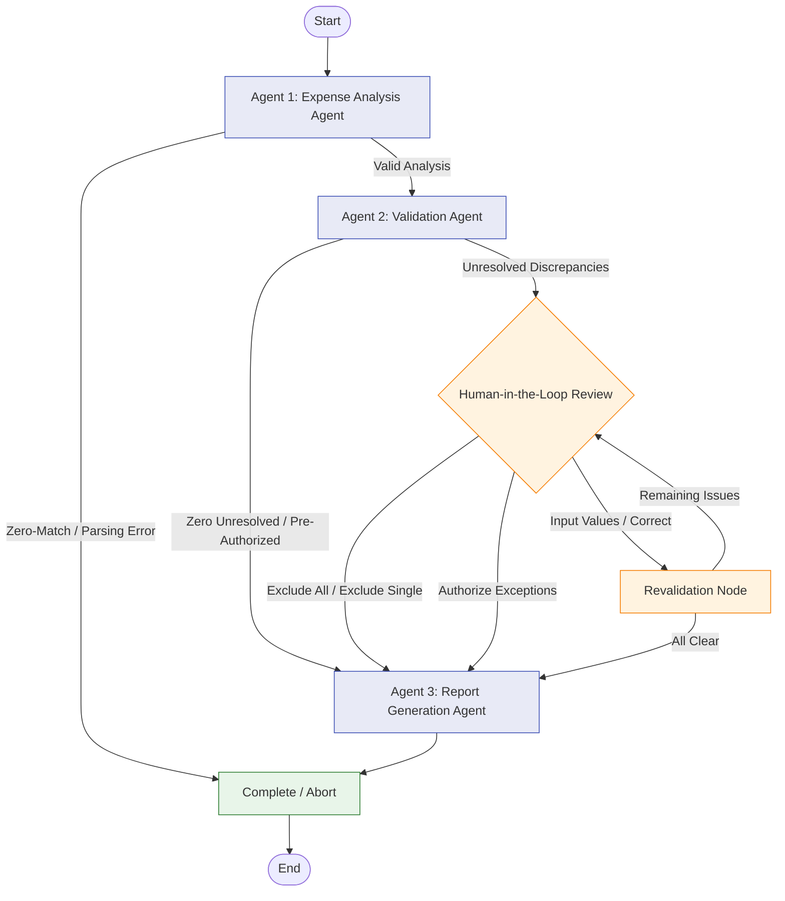

# 📖 AI Expense Report Agent — Comprehensive Project Documentation & Architecture Blueprint

> **Document Purpose**: This document provides a complete technical specification of the AI Expense Report Agent. It covers system architecture, the three specialized collaborating agents, the persistent SQLite memory v2 database schema, dataset isolation, Human-in-the-Loop review mechanisms, testing infrastructure, and extension blueprints.

---

## 📑 Table of Contents

1. [Executive Summary & Core Philosophy](#1-executive-summary--core-philosophy)
2. [Complete Workspace Structure](#2-complete-workspace-structure)
3. [System Architecture & Multi-Agent Graph](#3-system-architecture--multi-agent-graph)
4. [Persistent SQLite Memory System (`tools/memory_tools.py`)](#4-persistent-sqlite-memory-system-toolsmemory_toolspy)
   - [4.1 Database Separation & Architecture](#41-database-separation--architecture)
   - [4.2 Relational Schema v2 (`data/expense_memory.db`)](#42-relational-schema-v2-dataexpense_memorydb)
   - [4.3 Dataset Lifecycle & Cryptographic Deduplication](#43-dataset-lifecycle--cryptographic-deduplication)
   - [4.4 Reusable Memory Tool Reference](#44-reusable-memory-tool-reference)
5. [Multi-Agent Collaboration Specification](#5-multi-agent-collaboration-specification)
   - [5.1 Agent 1: Expense Analysis Agent](#51-agent-1-expense-analysis-agent)
   - [5.2 Agent 2: Validation Agent](#52-agent-2-validation-agent)
   - [5.3 Agent 3: Report Generation Agent](#53-agent-3-report-generation-agent)
   - [5.4 Structured Message Passing & Artifact Handoff](#54-structured-message-passing--artifact-handoff)
6. [Human-in-the-Loop (HITL) Review & Audit Lifecycle](#6-human-in-the-loop-hitl-review--audit-lifecycle)
   - [6.1 Interruption & Resumption Mechanism](#61-interruption--resumption-mechanism)
   - [6.2 Reviewer Actions & Direct Auditor Resolution](#62-reviewer-actions--direct-auditor-resolution)
   - [6.3 Persistent Memory of Auditor Decisions](#63-persistent-memory-of-auditor-decisions)
   - [6.4 Official Validation Status Model](#64-official-validation-status-model)
7. [State Schema (`state.py`)](#7-state-schema-statepy)
8. [Deterministic Tool Pipeline Reference](#8-deterministic-tool-pipeline-reference)
   - [8.1 Expense Tools (`tools/expense_tools.py`)](#81-expense-tools-toolsexpense_toolspy)
   - [8.2 Validation & Revalidation Tools (`tools/validation_tools.py`)](#82-validation--revalidation-tools-toolsvalidation_toolspy)
   - [8.3 Financial Math Engine (`tools/calculation_tools.py`)](#83-financial-math-engine-toolscalculation_toolspy)
   - [8.4 Publication-Grade PDF Engine (`tools/pdf_tools.py`)](#84-publication-grade-pdf-engine-toolspdf_toolspy)
   - [8.5 Email Drafting & Dispatch (`tools/email_tools.py`)](#85-email-drafting--dispatch-toolsemail_toolspy)
9. [User Interface Implementation (`app.py`)](#9-user-interface-implementation-apppy)
10. [Test Suites & Quality Assurance (`tests/`)](#10-test-suites--quality-assurance-tests)
11. [Configuration & Environment Variables](#11-configuration--environment-variables)
12. [Developer Guide: Extending or Pivoting to a New Problem Statement](#12-developer-guide-extending-or-pivoting-to-a-new-problem-statement)
13. [System Evaluation & Demonstration Playbook](#13-system-evaluation--demonstration-playbook)

---

## 1. Executive Summary & Core Philosophy

The **AI Expense Report Agent** is an enterprise-grade agentic system designed to ingest, validate, audit, and report organizational expenses. The system implements three collaborating AI agent roles, backed by persistent SQLite memory and human review checkpoints.

### Core Architectural Principles

1. **Strict Separation of Concerns**:
   - **Language Models (LLM)**: Used exclusively for **intent extraction**, **semantic interpretation**, and **executive drafting** (local Qwen 3 4B via Ollama). The LLM is **never** permitted to calculate numbers, filter records, or format binary documents.
   - **Deterministic Python / Pandas**: Handles 100% of arithmetic calculations, data filtering, receipt verification, duplicate detection, and ReportLab PDF document layout. This guarantees mathematical accuracy and eliminates hallucination risk.
2. **Dedicated Two-Tier SQLite Architecture**:
   - **Business Memory Database (`data/expense_memory.db`)**: Houses normalized domain entities (datasets, expenses, import hashes, validation issues, report runs, audit logs).
   - **Workflow Checkpoint Database (`.checkpoints/agent_state.db`)**: Used exclusively by LangGraph to serialize graph thread states, allowing long-running workflows to pause during human review and resume seamlessly.
3. **Multi-Agent Collaboration with Structured Contracts**:
   - Each agent has a single, well-defined responsibility.
   - Agents communicate through typed dictionary contracts stored in the graph state.
4. **Integrity Guard: No Silent Approvals**:
   - Expenses flagged with validation discrepancies cannot be silently approved. The Report Generation Agent will actively abort execution if unresolved issues remain without an authorized reviewer decision.
5. **Persistent Auditor Decision Memory**:
   - Decisions made by auditors (either during an interrupt or via the dedicated Compliance Audit tab) are recorded in SQLite memory. Future workflow runs recall these decisions so auditors are not prompted redundantly for previously resolved items.

---

## 2. Complete Workspace Structure

```
AI Agent Expense report/
├── .checkpoints/                   # SQLite database for LangGraph workflow state checkpoints
│   └── agent_state.db
├── .env                            # Active environment configuration
├── .env.example                    # Template environment file
├── .gitignore                      # Git exclusion rules
├── CSV_PROMPT_GUIDE.md             # Guide mapping CSV files to sample prompts & date distributions
├── PROJECT_INFO.md                 # Master project documentation (this document)
├── README.md                       # Project overview and quickstart guide
├── requirements.txt                # Python package dependencies
├── state.py                        # TypedDict schema defining AgentState and ParsedFilters
├── agent.py                        # LangGraph workflow connecting the three collaborating agents
├── app.py                          # Streamlit web UI, multi-agent monitor, HITL review & memory console
├── pytest.ini                      # Pytest runner configuration
├── task.md                         # Teach-Impeccable persistent design context & principles
├── data/
│   ├── expense_memory.db           # Dedicated persistent SQLite memory database (schema v2)
│   ├── expenses.csv                # Master dataset (170 entries, 5 employees, 5 months)
│   └── sample_csvs/                # Individual scenario datasets
├── reports/                        # Output directory for generated PDF expense reports
├── tests/                          # Consolidated automated test suite (324 tests)
│   ├── conftest.py                 # Shared pytest fixtures and isolated test environment setup
│   ├── test_milestone1_db.py       # Safe schema migration, backup creation, and dataset isolation
│   ├── test_milestone2_filters.py  # Canonical filter pipeline, employee discovery, location aliasing
│   ├── test_milestone3_compliance.py # Auditor direct resolution & persistent HITL memory
│   ├── test_e2e_tier1_features.py  # Core end-to-end features & dataset lifecycles
│   ├── test_e2e_tier2_boundaries.py# Edge cases, boundaries, and empty inputs
│   ├── test_e2e_tier3_combinations.py # Complex filter combinations
│   ├── test_e2e_tier4_scenarios.py # Realistic end-to-end user workflows
│   ├── test_e2e_tier5_adversarial.py# Adversarial hardening, fuzzing, SQL injection resistance
│   ├── test_memory_and_agents.py   # Integration tests for memory & multi-agent collaboration
│   ├── test_tools.py               # Functional test suite for core tools
│   └── test_email_tools.py         # Unit test suite for email drafting & simulation
└── tools/
    ├── __init__.py                 # Tool package initialization
    ├── memory_tools.py             # SQLite persistent memory v2, dataset registry & reviewer decisions
    ├── expense_tools.py            # CSV loading, currency cleaning, date/employee filtering
    ├── validation_tools.py         # Compliance audit, category inference, single-record revalidation
    ├── calculation_tools.py        # Financial aggregation, subtotals, per-employee breakdowns
    ├── pdf_tools.py                # ReportLab PDF engine with validation status badges
    └── email_tools.py              # Qwen 3 LLM email drafting & Resend API dispatch
```

---

## 3. System Architecture & Multi-Agent Graph

The system is organized as a stateful, directed graph built on **LangGraph**:



---

## 4. Persistent SQLite Memory System (`tools/memory_tools.py`)

### 4.1 Database Separation & Architecture
The system enforces clean database separation:
1. **`data/expense_memory.db`**: Stores business entities, dataset registry, deduplication hashes, validation findings, report runs, and audit logs.
2. **`.checkpoints/agent_state.db`**: Stores LangGraph serialized execution state frames.

### 4.2 Relational Schema v2 (`data/expense_memory.db`)

#### 1. `datasets` Master Table
Maintains dataset identity, versioning, and active tracking:
- `dataset_id` (TEXT PRIMARY KEY): `DS-xxxxxxxxxx`.
- `name` (TEXT NOT NULL).
- `source_filename` (TEXT NOT NULL).
- `file_hash` (TEXT NOT NULL): SHA-256 digest of source content.
- `row_count` (INTEGER NOT NULL).
- `schema_json` (TEXT NOT NULL): Metadata on discovered columns.
- `version` (INTEGER NOT NULL DEFAULT 1).
- `is_active` (INTEGER NOT NULL DEFAULT 0): Exactly one active dataset at a time.
- `created_at` (TEXT NOT NULL), `updated_at` (TEXT NOT NULL).

#### 2. `expenses_v2` Table
Stores raw and updated transaction records with null-resilience and dataset scoping:
- `id` (INTEGER PRIMARY KEY AUTOINCREMENT)
- `record_id` (TEXT NOT NULL): Deterministic stable identifier (`EXP-xxxxxxxxxxxx`).
- `dataset_id` (TEXT NOT NULL REFERENCES datasets(dataset_id))
- `dataset_version` (INTEGER NOT NULL DEFAULT 1)
- `expense_date` (TEXT NULL): Preserves `NULL` for missing dates without crashing.
- `employee` (TEXT NOT NULL).
- `description` (TEXT NOT NULL).
- `merchant` (TEXT NOT NULL).
- `category` (TEXT NOT NULL).
- `amount` (REAL NULL): Nullable float preserving raw missing amounts without `NOT NULL` constraint crashes.
- `receipt_status` (TEXT NOT NULL): e.g., "Verified", "Missing".
- `receipt_path` (TEXT).
- `location` (TEXT NULL): Normalized location support (handles city/destination headers).
- `payment_method` (TEXT NULL).
- `is_excluded` (INTEGER NOT NULL DEFAULT 0): Explicit exclusion flag.
- `source_file` (TEXT NOT NULL), `import_hash` (TEXT NOT NULL).
- `created_at` (TEXT NOT NULL), `updated_at` (TEXT NOT NULL).

#### 3. `validation_issues_v2` Table
Maintains the audit history of compliance findings scoped to dataset:
- `id` (INTEGER PRIMARY KEY AUTOINCREMENT)
- `issue_id` (TEXT UNIQUE NOT NULL): `ISSUE-xxxxxxxxxx`.
- `dataset_id` (TEXT NOT NULL REFERENCES datasets(dataset_id))
- `dataset_version` (INTEGER NOT NULL DEFAULT 1)
- `expense_record_id` (TEXT NOT NULL): Foreign key referencing `expenses_v2.record_id`.
- `issue_type` (TEXT NOT NULL): `missing_receipt`, `invalid_amount`, `missing_date`, `duplicate_expense`, etc.
- `field_name` (TEXT NOT NULL): Name of flagged field.
- `message` (TEXT NOT NULL): Human-readable explanation.
- `severity` (TEXT NOT NULL): `high`, `medium`, `low`.
- `status` (TEXT NOT NULL): `unresolved`, `resolved`, `accepted_exception`, `excluded`.
- `detected_at` (TEXT NOT NULL), `resolved_at` (TEXT).
- `reviewer_decision` (TEXT), `reviewer_notes` (TEXT).

#### 4. `report_runs_v2` Table
Records historical report generations scoped to dataset:
- `id` (INTEGER PRIMARY KEY AUTOINCREMENT)
- `run_id` (TEXT UNIQUE NOT NULL): `RUN-xxxxxxxxxx`.
- `report_id` (TEXT NOT NULL): `REP-xxxxxxxx`.
- `dataset_id` (TEXT NOT NULL REFERENCES datasets(dataset_id))
- `dataset_version` (INTEGER NOT NULL DEFAULT 1)
- `user_request` (TEXT NOT NULL).
- `filters_json` (TEXT NOT NULL): JSON of canonical filters.
- `transaction_ids_json` (TEXT NOT NULL): JSON array of included record IDs.
- `transaction_count` (INTEGER NOT NULL).
- `grand_total` (REAL NOT NULL).
- `validation_status` (TEXT NOT NULL): `Clear`, `Reviewed with Exceptions`, `Needs Human Review`.
- `report_file_path` (TEXT NOT NULL).
- `human_review_status` (TEXT NOT NULL): `None`, `Completed`.
- `created_at` (TEXT NOT NULL).

#### 5. `audit_events` Table
Maintains an immutable compliance log of every user action and data edit:
- `id` (INTEGER PRIMARY KEY AUTOINCREMENT)
- `event_id` (TEXT UNIQUE NOT NULL): `AUD-xxxxxxxxxx`.
- `dataset_id` (TEXT REFERENCES datasets(dataset_id))
- `event_type` (TEXT NOT NULL): `dataset_created`, `dataset_version_incremented`, `reviewer_correction`, `reviewer_exclusion`, `reviewer_exception_accepted`.
- `entity_type` (TEXT NOT NULL): `dataset`, `expense`, `validation_issue`.
- `entity_id` (TEXT NOT NULL).
- `details_json` (TEXT NOT NULL).
- `created_at` (TEXT NOT NULL).

#### 6. Backward-Compatibility Views
To ensure 100% compatibility with legacy scripts, SQLite views `expenses`, `validation_issues`, and `report_runs` are defined over the `_v2` tables using `INSTEAD OF` triggers (`trg_expenses_insert`, `trg_expenses_update`, `trg_expenses_delete`, etc.).

### 4.3 Dataset Lifecycle & Cryptographic Deduplication
- **SHA-256 Batch Hashing**: When a dataset is ingested via `save_expenses()`, an SHA-256 hash is computed over the normalized record payload.
- **Deduplication**: If the identical batch was already imported, the system skips re-inserting the rows and returns the existing records with their stable `record_id` values.
- **Multi-Dataset Isolation**: Datasets maintain strict boundaries. Switching active datasets updates all dropdowns, tables, and memory counters instantly.

### 4.4 Reusable Memory Tool Reference
- `init_memory_db(db_path)`: Safely initializes v2 tables, triggers, and indexes with automatic migration and backup.
- `create_or_get_dataset(name, file_hash, row_count, schema, db_path)`: Registers or fetches a dataset entity.
- `set_active_dataset(dataset_id, db_path)`: Exclusively activates a dataset.
- `get_active_dataset(db_path)`: Retrieves current active dataset metadata.
- `increment_dataset_version(dataset_id, updated_records, db_path)`: Increments dataset version and snapshots records.
- `save_expenses(expenses, dataset_id, dataset_version, source_name, db_path)`: Persists records with deduplication.
- `retrieve_expenses_from_db(dataset_id, dataset_version, employee, start_date, end_date, ...)`: Parameterized filtered query.
- `apply_reviewer_decision(action, record_id, dataset_id, ...)`: Updates record and issue statuses (`correct`, `exclude`, `accept_exception`).
- `get_unresolved_issues(dataset_id, db_path)`: Retrieves active open issues.
- `get_memory_stats(dataset_id, db_path)`: Summary metrics for UI display.

---

## 5. Multi-Agent Collaboration Specification

### 5.1 Agent 1: Expense Analysis Agent
- **Node**: `expense_analysis_agent_node`
- **Responsibilities**:
  1. Interprets natural language requests using Qwen 3 4B (with regex fallback for robustness).
  2. Resolves relative timeframes into strict `(start_date, end_date)` strings or preserves all-dates queries when no time period is specified.
  3. Synchronizes input data into persistent memory DB (`save_expenses`).
  4. Dynamically matches employee names against dataset entities without substring collision (zero hardcoding).
  5. Deterministically filters records by date range, employee, category, and location.
  6. Emits structured `expense_analysis` payload.

### 5.2 Agent 2: Validation Agent
- **Node**: `validation_agent_node`
- **Responsibilities**:
  1. Consumes `expense_analysis` output.
  2. Executes validation rules across candidate transactions (missing receipts, non-positive amounts, missing dates, duplicate charges).
  3. Inspects persistent memory: Checks whether issues have been pre-authorized (`accept_exception`) or excluded (`exclude`).
  4. Omits pre-excluded records from calculations.
  5. Determines whether Human-in-the-Loop review is required:
     - If all discrepancies are pre-authorized or excluded, the workflow **does not pause** and proceeds directly to Report Generation.
     - If unresolved issues remain, triggers the HITL interrupt.

### 5.3 Agent 3: Report Generation Agent
- **Node**: `report_generation_agent_node`
- **Responsibilities**:
  1. **Integrity Guard**: Asserts that unresolved issues are zero or that an authorized exception has been recorded. Never silently approves unresolved discrepancies.
  2. Calculates deterministic category totals, transaction counts, and employee breakdowns using Pandas.
  3. Renders publication-grade PDF using ReportLab with official **Validation Status Badges**.
  4. Records the completed report run in `report_runs_v2`.
  5. Emits structured `report_payload`.

### 5.4 Structured Message Passing & Artifact Handoff
Agents exchange data exclusively through the typed `AgentState` schema. No global variables, open socket connections, or binary objects are passed directly across graph boundaries.

---

## 6. Human-in-the-Loop (HITL) Review & Audit Lifecycle

### 6.1 Interruption & Resumption Mechanism
When the Validation Agent encounters un-audited compliance issues, it pauses execution via LangGraph's `interrupt()` primitive:
- State is serialized safely into `.checkpoints/agent_state.db`.
- The UI transitions to the `waiting_missing` phase and displays the review banner.
- Reviewer responses resume execution seamlessly via `Command(resume=...)`.

### 6.2 Reviewer Actions & Direct Auditor Resolution
Auditors can resolve issues in two ways:
1. **Interactive HITL Review (Tab 1)**:
   - **Exclude All Flagged Items**: Removes all flagged records from calculations.
   - **Authorize Documented Exceptions**: Approves all flagged records under managerial exception policy.
   - **Input Missing Values**: Provides missing amount, date, or receipt status and queues revalidation.
   - **Exclude Only {Record ID}**: Excludes a single incomplete record while retaining the rest.
   - **Authorize Exception for {Record ID}**: Authorizes a single record exception.
2. **Auditor Direct Resolution (Tab 4)**:
   - Directly select any open discrepancy and apply `❌ Exclude from Counting & Reports` or `✅ Authorize Managerial Exception`.

### 6.3 Persistent Memory of Auditor Decisions
- Any decision applied via Tab 4 or during HITL review is immediately committed to `expenses_v2` (`is_excluded = 1` if excluded) and `validation_issues_v2` (`status = 'accepted_exception'` or `'excluded'`).
- On future workflow runs, the Validation Agent recognizes the stored decision. If all flagged items for a query have recorded decisions, **the workflow does not interrupt** and produces the final report immediately.

### 6.4 Official Validation Status Model
- `Clear`: All validation checks passed, zero unresolved discrepancies.
- `Reviewed with Exceptions`: Proceeded under authorized managerial exception policy with complete audit notes.
- `Needs Human Review`: Blocked from final approval due to unresolved issues.

---

## 7. State Schema (`state.py`)

The graph state is defined by `AgentState`:

```python
class AgentState(TypedDict):
    messages: Annotated[list[AnyMessage], add_messages]
    user_request: str
    start_date: Optional[str]
    end_date: Optional[str]
    expense_type: str
    expenses: list[dict]
    filtered_expenses: list[dict]
    categorized_expenses: list[dict]
    missing_data: list[dict]
    totals: dict
    pdf_path: str
    workflow_status: list[str]
    awaiting_input: str
    human_response: str
    error: str
    employee_name: str
    target_employee: Optional[str]
    recipient_email: str
    email_subject: str
    email_body: str
    email_status: str
    dataset_id: Optional[str]
    dataset_version: Optional[int]
    parsed_filters: Optional[Dict[str, Any]]
```

---

## 8. Deterministic Tool Pipeline Reference

- **`tools/expense_tools.py`**: Reads CSVs, normalizes currency strings, extracts locations, and filters deterministically across dates, employees, and categories.
- **`tools/validation_tools.py`**: Performs deterministic compliance checks (missing receipts, non-zero amounts, duplicate transactions).
- **`tools/calculation_tools.py`**: Computes category totals and grand totals using Pandas; strictly omits excluded records (`is_excluded = 1`).
- **`tools/pdf_tools.py`**: Compiles vector PDF documents using ReportLab, dynamically rendering single-employee or consolidated team reports with official validation badges.
- **`tools/email_tools.py`**: Generates executive email summaries and dispatches via Resend API or simulation mode.

---

## 9. User Interface Implementation (`app.py`)

The Streamlit UI provides 4 dedicated workspaces:
1. **📊 Executive Workspace & Execution**: Interactive table editor, natural language prompt input, collaboration stage trackers, live chronological audit feed, HITL review console, financial ribbon, and email console.
2. **📜 Prompt & Report Run History**: Searchable archive of past report runs scoped to the active dataset with one-click actions to reload prompt, rerun, or download PDF.
3. **🧠 Persistent SQLite Memory & Ingestion**: Live database KPIs, dataset switcher, CSV uploader, and interactive table explorer.
4. **🛡️ Compliance & Validation Issues**: Dedicated compliance management console with Auditor Direct Resolution controls.

---

## 10. Test Suites & Quality Assurance (`tests/`)

All automated test suites are consolidated in the [`tests/`](tests/) folder and run with `pytest`:

```bash
# Run the complete test suite (324 tests)
pytest

# Run specific functional test suites:
pytest tests/test_milestone1_db.py           # Safe migration & dataset isolation
pytest tests/test_milestone2_filters.py      # Canonical filters & employee matching
pytest tests/test_milestone3_compliance.py   # Auditor direct resolution & persistent HITL memory
pytest tests/test_e2e_tier1_features.py      # Core end-to-end features
pytest tests/test_e2e_tier5_adversarial.py   # Adversarial hardening & fuzzing
```

---

## 11. Configuration & Environment Variables

Variables are configured in [`.env`](.env):

```env
OLLAMA_MODEL=qwen3:4b
OLLAMA_BASE_URL=http://localhost:11434
EXPENSE_CSV_PATH=data/expenses.csv
EXPENSE_MEMORY_DB_PATH=data/expense_memory.db
RESEND_API_KEY=
RESEND_FROM_EMAIL=onboarding@resend.dev
DEFAULT_RECIPIENT_EMAIL=
```

---

## 12. Developer Guide: Extending or Pivoting to a New Problem Statement

To adapt this engine to a new domain (e.g., **Invoice Approval**, **Vendor Audits**, **Leave Requests**):
1. **Redefine Schema in SQLite (`tools/memory_tools.py`)**: Update tables to store domain entities.
2. **Extend State Schema (`state.py`)**: Add domain-specific attributes to `AgentState`.
3. **Adapt Analysis Agent (`agent.py`)**: Update intent prompt to extract domain entities.
4. **Adapt Validation Agent (`tools/validation_tools.py`)**: Implement domain compliance checks.
5. **Adapt Report Generation Agent (`tools/pdf_tools.py`)**: Update ReportLab layout for the domain report.

---

## 13. System Evaluation & Demonstration Playbook

### 🎯 Demonstration 1: Persistent SQLite Memory
1. Open tab **"🧠 Persistent SQLite Memory & Ingestion"**.
2. Notice dataset metadata and memory counters.
3. Ingesting identical CSV files triggers cryptographic deduplication without duplicating records.

### 🎯 Demonstration 2: Multi-Agent Collaboration
1. Enter: `"Travel expenses for Priya Sharma in August 2026"`.
2. Observe chronological feed as Agent 1 parses intent and matches employee, Agent 2 audits compliance, and Agent 3 generates the vector PDF report.

### 🎯 Demonstration 3: Persistent Auditor Resolution
1. Open tab **"🛡️ Compliance & Validation Issues"**.
2. For any flagged transaction, select `✅ Authorize Managerial Exception` or `❌ Exclude from Counting & Reports` and apply.
3. Run the workflow again on Tab 1: **the agent remembers your resolution and does NOT stop for approval** — it completes automatically!
