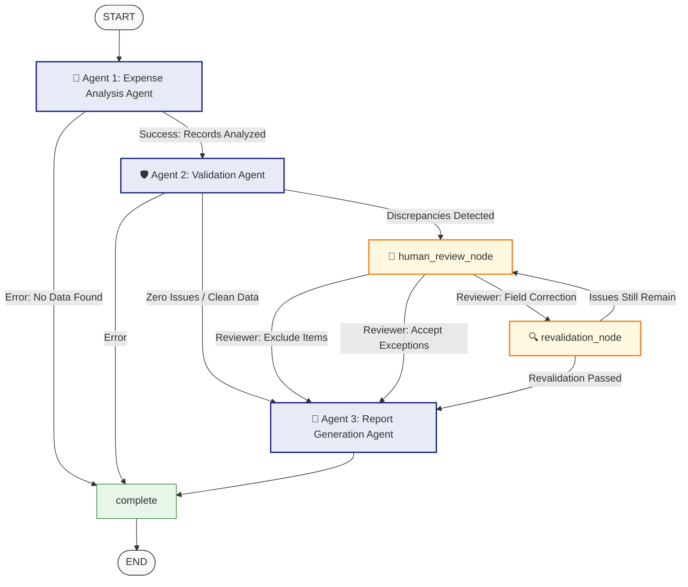

# 📖 AI Expense Report Agent — Comprehensive Project Documentation & Extension Guide

> **Document Purpose**: This document provides a complete technical specification of the AI Expense Report Agent, detailing the implementation of **Unit III (Persistent SQLite Memory & Tool Interaction)** and **Unit IV (Multi-Agent Collaboration)**. It covers system architecture, the three specialized collaborating agents, the database schema, Human-in-the-Loop review mechanisms, testing infrastructure, and extension blueprints.

---

## 📑 Table of Contents

1. [Executive Summary & Core Philosophy](#1-executive-summary--core-philosophy)
2. [Complete Workspace Structure](#2-complete-workspace-structure)
3. [System Architecture & Multi-Agent Graph](#3-system-architecture--multi-agent-graph)
4. [Unit III: Persistent SQLite Memory System (`tools/memory_tools.py`)](#4-unit-iii-persistent-sqlite-memory-system-toolsmemory_toolspy)
   - [4.1 Database Separation & Architecture](#41-database-separation--architecture)
   - [4.2 Relational Schema (`data/expense_memory.db`)](#42-relational-schema-dataexpense_memorydb)
   - [4.3 Import Safety & Cryptographic Deduplication](#43-import-safety--cryptographic-deduplication)
   - [4.4 Reusable Memory Tool Reference](#44-reusable-memory-tool-reference)
5. [Unit IV: Multi-Agent Collaboration Specification](#5-unit-iv-multi-agent-collaboration-specification)
   - [5.1 Agent 1: Expense Analysis Agent](#51-agent-1-expense-analysis-agent)
   - [5.2 Agent 2: Validation Agent](#52-agent-2-validation-agent)
   - [5.3 Agent 3: Report Generation Agent](#53-agent-3-report-generation-agent)
   - [5.4 Structured Message Passing & Artifact Handoff](#54-structured-message-passing--artifact-handoff)
6. [Human-in-the-Loop (HITL) Review & Audit Lifecycle](#6-human-in-the-loop-hitl-review--audit-lifecycle)
   - [6.1 Interruption & Resumption Mechanism](#61-interruption--resumption-mechanism)
   - [6.2 Reviewer Actions: Exclude, Accept Exception, and Inline Revalidation](#62-reviewer-actions-exclude-accept-exception-and-inline-revalidation)
   - [6.3 Official Validation Status Model](#63-official-validation-status-model)
7. [State Schema (`state.py`)](#7-state-schema-statepy)
8. [Deterministic Tool Pipeline Reference](#8-deterministic-tool-pipeline-reference)
   - [8.1 Expense Tools (`tools/expense_tools.py`)](#81-expense-tools-toolsexpense_toolspy)
   - [8.2 Validation & Revalidation Tools (`tools/validation_tools.py`)](#82-validation--revalidation-tools-toolsvalidation_toolspy)
   - [8.3 Financial Math Engine (`tools/calculation_tools.py`)](#83-financial-math-engine-toolscalculation_toolspy)
   - [8.4 Publication-Grade PDF Engine (`tools/pdf_tools.py`)](#84-publication-grade-pdf-engine-toolspdf_toolspy)
   - [8.5 Email Drafting & Dispatch (`tools/email_tools.py`)](#85-email-drafting--dispatch-toolsemail_toolspy)
9. [User Interface Implementation (`app.py`)](#9-user-interface-implementation-apppy)
10. [Test Suites & Quality Assurance](#10-test-suites--quality-assurance)
11. [Configuration & Environment Variables](#11-configuration--environment-variables)
12. [Developer Guide: Extending or Pivoting to a New Problem Statement](#12-developer-guide-extending-or-pivoting-to-a-new-problem-statement)
13. [Academic Evaluation & Demonstration Playbook (Units III & IV)](#13-academic-evaluation--demonstration-playbook-units-iii--iv)

---

## 1. Executive Summary & Core Philosophy

The **AI Expense Report Agent** is an enterprise-grade agentic system designed to ingest, validate, audit, and report organizational expenses. The system implements three collaborating AI agent roles, backed by persistent SQLite memory and human review checkpoints.

### Core Architectural Principles

1. **Strict Separation of Concerns**:
   - **Language Models (LLM)**: Used exclusively for **intent extraction**, **semantic interpretation**, and **executive drafting** (local Qwen 3 4B via Ollama). The LLM is **never** permitted to calculate numbers, filter records, or format binary documents.
   - **Deterministic Python / Pandas**: Handles 100% of arithmetic calculations, data filtering, receipt verification, duplicate detection, and ReportLab PDF document layout. This guarantees mathematical accuracy and eliminates hallucination risk.
2. **Dedicated Two-Tier SQLite Architecture**:
   - **Business Memory Database (`data/expense_memory.db`)**: Houses normalized domain entities (expenses, import hashes, validation issues, report runs, audit logs).
   - **Workflow Checkpoint Database (`.checkpoints/agent_state.db`)**: Used exclusively by LangGraph to serialize graph thread states, allowing long-running workflows to pause during human review and resume seamlessly.
3. **Multi-Agent Collaboration with Structured Contracts**:
   - Each agent has a single, well-defined responsibility.
   - Agents communicate through typed dictionary contracts stored in the graph state.
4. **Integrity Guard: No Silent Approvals**:
   - Expenses flagged with validation discrepancies cannot be silently approved. The Report Generation Agent will actively abort execution if unresolved issues remain without an authorized reviewer decision.

---

## 2. Complete Workspace Structure

```
AI Agent Expense report/
├── .checkpoints/                   # SQLite database for LangGraph workflow state checkpoints
│   └── agent_state.db
├── .env                            # Active environment configuration
├── .env.example                    # Template environment file
├── .gitignore                      # Git exclusion rules
├── CSV_PROMPT_GUIDE.md             # Guide mapping CSV files to sample prompts & date distributions
├── PROJECT_INFO.md                 # Master project documentation (this document)
├── README.md                       # Project overview and quickstart guide
├── requirements.txt                # Python package dependencies
├── state.py                        # TypedDict schema defining AgentState
├── agent.py                        # LangGraph workflow connecting the three collaborating agents
├── app.py                          # Streamlit web UI, multi-agent monitor, HITL review & memory console
├── test_tools.py                   # Automated functional test suite for core tools
├── test_email_tools.py             # Unit test suite for email drafting & simulation
├── test_memory_and_agents.py       # Comprehensive unit & integration tests for Unit III & IV
├── data/
│   ├── expense_memory.db           # Unit III: Dedicated persistent SQLite memory database
│   ├── expenses.csv                # Master dataset (170 entries, 5 employees, 5 months)
│   └── sample_csvs/                # Individual scenario datasets
├── reports/                        # Output directory for generated PDF expense reports
└── tools/
    ├── __init__.py                 # Tool package initialization
    ├── memory_tools.py             # Unit III: SQLite persistent memory, deduplication & issue tracking
    ├── expense_tools.py            # CSV loading, currency cleaning, date/employee filtering
    ├── validation_tools.py         # Compliance audit, category inference, single-record revalidation
    ├── calculation_tools.py        # Financial aggregation, subtotals, per-employee breakdowns
    ├── pdf_tools.py                # ReportLab PDF engine with validation status badges
    └── email_tools.py              # Qwen 3 LLM email drafting & Resend API dispatch
```

---

## 3. System Architecture & Multi-Agent Graph

The system is organized as a stateful, directed graph built on **LangGraph**:



---

## 4. Unit III: Persistent SQLite Memory System (`tools/memory_tools.py`)

### 4.1 Database Separation & Architecture
The system enforces clean database separation:
1. **`data/expense_memory.db`**: Stores business entities, deduplication hashes, validation findings, report runs, and audit logs.
2. **`.checkpoints/agent_state.db`**: Stores LangGraph serialized execution state frames.

### 4.2 Relational Schema (`data/expense_memory.db`)

#### 1. `expenses` Table
Stores raw and updated transaction records:
- `id` (INTEGER PRIMARY KEY AUTOINCREMENT)
- `record_id` (TEXT UNIQUE NOT NULL): Deterministic stable identifier (`EXP-xxxxxxxx`).
- `expense_date` (TEXT NOT NULL): `YYYY-MM-DD`.
- `employee` (TEXT NOT NULL).
- `description` (TEXT NOT NULL).
- `merchant` (TEXT NOT NULL).
- `category` (TEXT NOT NULL).
- `amount` (REAL NOT NULL).
- `receipt_status` (TEXT NOT NULL): e.g., "Verified", "Missing".
- `receipt_path` (TEXT): Local file path if receipt attached.
- `source_file` (TEXT NOT NULL).
- `import_hash` (TEXT NOT NULL): Cryptographic fingerprint of ingestion batch.
- `created_at` (TEXT NOT NULL), `updated_at` (TEXT NOT NULL).

#### 2. `import_batches` Table
Tracks ingested file hashes to prevent accidental duplicate insertions:
- `id` (INTEGER PRIMARY KEY AUTOINCREMENT)
- `batch_id` (TEXT UNIQUE NOT NULL)
- `source_name` (TEXT NOT NULL)
- `file_hash` (TEXT NOT NULL)
- `record_count` (INTEGER NOT NULL)
- `imported_at` (TEXT NOT NULL)

#### 3. `validation_issues` Table
Maintains the audit history of compliance findings:
- `id` (INTEGER PRIMARY KEY AUTOINCREMENT)
- `issue_id` (TEXT UNIQUE NOT NULL): `ISSUE-xxxxxxxx`.
- `expense_record_id` (TEXT NOT NULL): Foreign key referencing `expenses.record_id`.
- `issue_type` (TEXT NOT NULL): `missing_receipt`, `invalid_amount`, `missing_date`, `duplicate`, etc.
- `field_name` (TEXT NOT NULL): Name of flagged field.
- `message` (TEXT NOT NULL): Human-readable explanation.
- `severity` (TEXT NOT NULL): `high`, `medium`, `low`.
- `status` (TEXT NOT NULL): `unresolved`, `resolved`, `accepted_exception`, `excluded`.
- `detected_at` (TEXT NOT NULL), `resolved_at` (TEXT).
- `reviewer_decision` (TEXT), `reviewer_notes` (TEXT).

#### 4. `report_runs` Table
Records historical report generations:
- `id` (INTEGER PRIMARY KEY AUTOINCREMENT)
- `report_id` (TEXT UNIQUE NOT NULL): `REP-xxxxxxxx`.
- `user_request` (TEXT NOT NULL).
- `filters_json` (TEXT NOT NULL): JSON of date, employee, and type filters.
- `transaction_ids_json` (TEXT NOT NULL): JSON array of included record IDs.
- `transaction_count` (INTEGER NOT NULL).
- `grand_total` (REAL NOT NULL).
- `validation_status` (TEXT NOT NULL): `Clear`, `Reviewed with Exceptions`, `Needs Human Review`.
- `report_file_path` (TEXT NOT NULL).
- `human_review_status` (TEXT NOT NULL): `None`, `Completed`.
- `created_at` (TEXT NOT NULL).

### 4.3 Import Safety & Cryptographic Deduplication
- When a dataset is ingested via `save_expenses()`, an SHA-256 hash is computed over the normalized record payload.
- If the identical batch was already imported, the system skips re-inserting the rows and returns the existing records with their stable `record_id` values.
- Legitimate duplicates (e.g., two distinct transactions on the same day with the same merchant and amount) are preserved so the Validation Agent can flag them for review.

### 4.4 Reusable Memory Tool Reference
- `init_memory_db(db_path)`: Safely initializes tables and indexes.
- `save_expenses(expenses, source_name, db_path)`: Persists records with deduplication.
- `retrieve_expenses_from_db(employee, start_date, end_date, category, expense_type, db_path)`: Filtered query.
- `get_previous_expenses(employee, limit, db_path)`: Retrieves recent transactions.
- `save_validation_issues(issues, db_path)`: Persists compliance discrepancies.
- `update_expense_record(record_id, updates, db_path)`: Applies reviewer field corrections.
- `resolve_validation_issue(issue_id, decision, notes, db_path)`: Updates issue resolution status.
- `save_report_run(report_data, db_path)`: Saves report run metadata.
- `get_report_history(limit, db_path)`: Retrieves historical reports.
- `get_unresolved_issues(employee, db_path)`: Retrieves active open issues.
- `get_memory_stats(db_path)`: Summary metrics for UI display.

---

## 5. Unit IV: Multi-Agent Collaboration Specification

### 5.1 Agent 1: Expense Analysis Agent
- **Node**: `expense_analysis_agent_node`
- **Responsibilities**:
  1. Interprets natural language requests using Qwen 3 4B (with regex fallback for robustness).
  2. Resolves relative timeframes (e.g., "last month", "August 2026") into strict `(start_date, end_date)` strings.
  3. Synchronizes input data into persistent memory DB (`save_expenses`).
  4. Dynamically matches employee names against dataset entities (zero hardcoding).
  5. Deterministically filters records by date range, employee, and category ("travel" vs "all").
  6. Classifies transactions using rule-based categorization.
  7. Emits structured `expense_analysis` payload.

### 5.2 Agent 2: Validation Agent
- **Node**: `validation_agent_node`
- **Responsibilities**:
  1. Consumes `expense_analysis` output.
  2. Executes validation rules across all candidate transactions:
     - Missing receipt verification (`receipt_status` in `("missing", "no", "n/a")`).
     - Non-positive or null amount checking (`amount <= 0`).
     - Missing date, description, or category checking.
     - Potential duplicate transaction candidate detection.
  3. Persists issues into `data/expense_memory.db`.
  4. Sets `validation_status`: `"Needs Human Review"` if issues exist, else `"Clear"`.
  5. Sets `awaiting_input = "missing_data"` to trigger HITL interrupt when necessary.

### 5.3 Agent 3: Report Generation Agent
- **Node**: `report_generation_agent_node`
- **Responsibilities**:
  1. **Integrity Guard**: Asserts that `unresolved_count == 0` or that an authorized exception has been recorded. Never silently approves unresolved discrepancies.
  2. Calculates deterministic category totals, transaction counts, and employee breakdowns using Pandas.
  3. Renders publication-grade PDF using ReportLab with official **Validation Status Badges**.
  4. Records the completed report run in `data/expense_memory.db`.
  5. Emits structured `report_payload`.

### 5.4 Structured Message Passing & Artifact Handoff
Agents exchange data exclusively through the typed `AgentState` schema. No global variables, open socket connections, or binary objects are passed directly across graph boundaries.

---

## 6. Human-in-the-Loop (HITL) Review & Audit Lifecycle

### 6.1 Interruption & Resumption Mechanism
When the Validation Agent flags discrepancies, execution suspends via LangGraph's `interrupt()` primitive. The workflow state is frozen in `.checkpoints/agent_state.db` and rendered in the Streamlit UI.

### 6.2 Reviewer Actions
The reviewer has three options:
1. **Accept with Documented Exception**:
   - Reviewer enters authorization notes.
   - Resumes with `"include"`.
   - Issues are marked `accepted_exception` in the database.
   - Status becomes `Reviewed with Exceptions`.
2. **Exclude from Report**:
   - Flagged transactions are stripped from report calculations.
   - Issues are marked `excluded` in the database.
   - Resumes with `"exclude"`.
   - Status becomes `Clear`.
3. **Correct Record & Revalidate**:
   - Reviewer updates a flagged field (e.g. changes `receipt_status` to "Verified" or enters corrected amount).
   - Updates record in `data/expense_memory.db`.
   - Graph routes to `revalidation_node`.
   - If all issues are resolved, status becomes `Clear`; otherwise re-prompts the reviewer.

### 6.3 Official Validation Status Model

| Status | Meaning | Final Report Permitted? | PDF Header Callout |
| :--- | :--- | :--- | :--- |
| **`Clear`** | 100% compliant, zero unresolved issues. | Yes | Green: `VERIFIED & CLEAR` |
| **`Reviewed with Exceptions`** | Proceeded under documented managerial policy. | Yes | Amber: `REVIEWED WITH DOCUMENTED EXCEPTIONS` |
| **`Needs Human Review`** | Discrepancies flagged; awaiting decision. | No (Diagnostic only) | Red/Orange: `AWAITING HUMAN REVIEW` |

---

## 7. State Schema (`state.py`)

File: [`state.py`](file:///c:/Users/Space/OneDrive/Documents/AI%20Agent%20Expense%20report/state.py)

```python
class AgentState(TypedDict, total=False):
    messages: Annotated[list, add_messages]
    
    # Identification & Memory
    report_run_id: str          # e.g., "REP-xxxxxxxx"
    data_source: str            # 'memory_db' | 'csv_file' | 'interactive_editor'
    
    # Request Parsing
    user_request: str
    start_date: str
    end_date: str
    expense_type: str
    employee_name: str
    target_employee: str
    
    # Multi-Agent Outputs
    expense_analysis: dict      # Output from Agent 1 (Expense Analysis Agent)
    validation_findings: list   # Output from Agent 2 (Validation Agent)
    unresolved_count: int       # Active discrepancy count
    validation_status: str      # 'Clear' | 'Needs Human Review' | 'Reviewed with Exceptions'
    
    # Human Review (HITL)
    human_decisions: list       # Audit trail of reviewer actions
    human_response: str         # "include" | "exclude" | "correct"
    
    # Output Payload
    report_payload: dict        # Output from Agent 3 (Report Generation Agent)
    
    # Data Pipeline (Backward Compatible)
    expenses: list
    filtered_expenses: list
    categorized_expenses: list
    missing_data: list
    totals: dict
    pdf_path: str
    
    # Email Dispatch
    recipient_email: str
    email_subject: str
    email_body: str
    email_status: str
    
    # Logging & Flow Control
    agent_logs: list            # [{"agent": str, "message": str, "timestamp": str}]
    workflow_status: list
    awaiting_input: str
    error: str
```

---

## 8. Deterministic Tool Pipeline Reference

- [`tools/memory_tools.py`](file:///c:/Users/Space/OneDrive/Documents/AI%20Agent%20Expense%20report/tools/memory_tools.py): SQLite persistent memory, deduplication, report run history, and audit updates.
- [`tools/expense_tools.py`](file:///c:/Users/Space/OneDrive/Documents/AI%20Agent%20Expense%20report/tools/expense_tools.py): CSV loading, currency cleaning, date/employee filtering.
- [`tools/validation_tools.py`](file:///c:/Users/Space/OneDrive/Documents/AI%20Agent%20Expense%20report/tools/validation_tools.py): Compliance audit, category inference, single-record revalidation.
- [`tools/calculation_tools.py`](file:///c:/Users/Space/OneDrive/Documents/AI%20Agent%20Expense%20report/tools/calculation_tools.py): Pandas arithmetic, subtotals, missing receipt totals, per-employee breakdowns.
- [`tools/pdf_tools.py`](file:///c:/Users/Space/OneDrive/Documents/AI%20Agent%20Expense%20report/tools/pdf_tools.py): ReportLab PDF engine generating publication-grade single and multi-employee reports with validation status banners.
- [`tools/email_tools.py`](file:///c:/Users/Space/OneDrive/Documents/AI%20Agent%20Expense%20report/tools/email_tools.py): Qwen 3 email draft generation, Base64 PDF attachment, Resend API dispatch, and simulation mode.

---

## 9. User Interface Implementation (`app.py`)

File: [`app.py`](file:///c:/Users/Space/OneDrive/Documents/AI%20Agent%20Expense%20report/app.py)

Key UI sections:
1. **Interactive Data Editor & Uploader**: Edit data inline or upload custom CSVs.
2. **🧠 Persistent SQLite Memory Tab**:
   - Displays real-time database KPIs (Total Records, Tracked Employees, Open Issues, Stored Reports).
   - "Ingest Master CSV to Memory" one-click action.
   - "Historical Report Runs" viewer with one-click PDF downloads.
   - "Unresolved Validation Issues" live audit viewer.
3. **Multi-Agent Collaboration Progress**:
   - Displays chronological, styled status logs from the collaborating agents.
   - Expandable structured execution logs.
4. **Human-in-the-Loop Review Console**:
   - Structured table of flagged transactions with severity indicators.
   - Three tabbed reviewer controls:
     - Tab 1: Authorize with Documented Exceptions.
     - Tab 2: Exclude Flagged Items from Report.
     - Tab 3: Inline Field Correction & Revalidation.
5. **Final Results Panel**:
   - Official Validation Status Badge (`VERIFIED & CLEAR`, `REVIEWED WITH DOCUMENTED EXCEPTIONS`).
   - Financial calculation metrics cards.
   - Download button for final ReportLab PDF.
   - AI Email drafting and dispatch console.

---

## 10. Test Suites & Quality Assurance

The system maintains three automated test suites:

1. **`test_tools.py`**:
   - Validates CSV loading, filtering, categorization, duplicate detection, calculations, PDF generation, and dynamic regex intent extraction.
   - Command: `python test_tools.py`
2. **`test_email_tools.py`**:
   - Unit tests for email drafting, email address validation, PDF Base64 attachment encoding, and SMTP/Resend simulation mode.
   - Command: `python -m unittest test_email_tools.py`
3. **`test_memory_and_agents.py`**:
   - Comprehensive unit and integration tests covering:
     - SQLite database initialization and schema creation.
     - Deduplicated batch ingestion and query filtering.
     - Validation issue persistence and resolution.
     - Expense record correction and revalidation.
     - Agent 1 (Expense Analysis Agent) structured output.
     - Agent 2 (Validation Agent) compliance checks and issue flagging.
     - Agent 3 (Report Generation Agent) deterministic calculations and integrity guards.
     - Human Review actions (exclude, accept exception, correct).
   - Command: `python -m unittest test_memory_and_agents.py`

---

## 11. Configuration & Environment Variables

Environment variables are loaded from [`.env`](file:///c:/Users/Space/OneDrive/Documents/AI%20Agent%20Expense%20report/.env):

```env
# Ollama Model & Base URL
OLLAMA_MODEL=qwen3:4b
OLLAMA_BASE_URL=http://localhost:11434

# Data & Memory Paths
EXPENSE_CSV_PATH=data/expenses.csv
EXPENSE_MEMORY_DB_PATH=data/expense_memory.db

# Email Service Configuration (Resend API)
RESEND_API_KEY=
RESEND_FROM_EMAIL=onboarding@resend.dev
DEFAULT_RECIPIENT_EMAIL=
```

---

## 12. Developer Guide: Extending or Pivoting to a New Problem Statement

To adapt this multi-agent, persistent-memory engine to a new problem statement (e.g., **Invoice Approval**, **Employee Leave Audits**, **Procurement Requisitions**):

1. **Redefine Domain Schema in SQLite (`tools/memory_tools.py`)**:
   - Update `expenses` table to reflect new domain fields (e.g., `invoices` with `po_number`, `vendor`, `tax_id`, `net_amount`).
2. **Extend Graph State in `state.py`**:
   - Update `AgentState` TypedDict to include domain-specific fields.
3. **Adapt Agent 1 (Analysis Agent)**:
   - Update LLM intent prompt and regex fallback in `agent.py` to extract domain entities.
4. **Adapt Agent 2 (Validation Agent)**:
   - Update `tools/validation_tools.py` to check domain-specific compliance rules (e.g. PO matching, tax calculation checks).
5. **Adapt Agent 3 (Report Generation Agent)**:
   - Update ReportLab layout in `tools/pdf_tools.py` to format the domain-specific audit report.
6. **Update Streamlit UI in `app.py`**:
   - Update table headers, metric cards, and review controls.

---

## 13. Academic Evaluation & Demonstration Playbook (Units III & IV)

This section provides an actionable script for evaluating the requirements of **Unit III (Persistent Memory)** and **Unit IV (Multi-Agent Collaboration)**.

### 🎯 Demonstration 1: Unit III — Persistent SQLite Memory

#### Step 1: Show Dedicated Database Architecture
- **Concept**: Separation of business domain data from workflow state checkpoints.
- **Artifacts to display**:
  - Domain Database: [`data/expense_memory.db`](file:///c:/Users/Space/OneDrive/Documents/AI%20Agent%20Expense%20report/data/expense_memory.db) (Expenses, Batches, Validation Issues, Report Runs).
  - Checkpoint Database: [`.checkpoints/agent_state.db`](file:///c:/Users/Space/OneDrive/Documents/AI%20Agent%20Expense%20report/.checkpoints/agent_state.db) (LangGraph thread execution states).

#### Step 2: Live Ingestion & Cryptographic Deduplication
- **In Streamlit (`http://localhost:8501`)**:
  1. Open tab: **"🧠 Persistent SQLite Memory & History"**.
  2. Click **"📥 Ingest Master CSV to Memory"** once:
     - Notice notification: `✓ Ingested 170 new records (0 duplicates skipped). Total: 170`.
  3. Click the button a second time:
     - Notice notification: `✓ Ingested 0 new records (170 duplicates skipped). Total: 170`.
  4. **Key Point**: The system computes an SHA-256 batch hash; repeated ingestion never creates duplicate records in memory.

#### Step 3: Historical Retrieval Without Re-uploading
- **In Streamlit**:
  1. Enter request: `"Generate August 2026 travel report for Priya Sharma"`.
  2. Leave custom file upload empty. Click **"🚀 Execute Multi-Agent Workflow"**.
  3. Point to the progress badge:
     `✓ [Expense Analysis Agent] Retrieved 170 records from persistent memory (memory_db)`.
  4. **Key Point**: The agent retrieves historical records directly from SQLite without needing any CSV file uploaded.

#### Step 4: Issue Persistence & Human Resolution
- **In Streamlit**:
  1. When flagged with missing receipts during HITL review, click **"✅ Accept with Managerial Exception"**.
  2. Enter note: `"Authorized by Manager"`.
  3. Revisit the **"🧠 Persistent SQLite Memory & History"** tab under **"⚠️ Unresolved Validation Issues"**:
     - Notice the issue was updated to `accepted_exception` in SQLite and cleared from active issues.

#### Step 5: Report Run History Archiving
- **In Streamlit**:
  1. In the **"🧠 Persistent SQLite Memory & History"** tab, open **"📜 Historical Report Runs"**.
  2. View the stored run ID (`REP-xxxxxxxx`), grand total, validation status (`Reviewed with Exceptions`), and click the **"⬇️ Download"** button.

---

### 🎯 Demonstration 2: Unit IV — Multi-Agent Collaboration

#### Step 1: Clear Separation of Agent Roles
- **In Streamlit UI & Logs**:
  - **Agent 1 (Expense Analysis Agent)**: Resolves date range, matches employee dynamically, filters deterministically, categorizes expenses, and emits `expense_analysis`.
  - **Agent 2 (Validation Agent)**: Runs receipt, amount, and duplicate audits; saves structured findings to memory; flags need for human review.
  - **Agent 3 (Report Generation Agent)**: Validates authorization; computes deterministic math; renders ReportLab PDF with official status badge; archives report run to SQLite.

#### Step 2: Integrity Guard Verification
- **Concept**: Unresolved compliance issues can **never** be silently approved.
- If discrepancies exist without a reviewer decision, Agent 3 aborts execution rather than outputting a false approval report.

#### Step 3: Official Validation Status Badges
- Point out the status callout in the generated PDF and UI:
  - `VERIFIED & CLEAR` (Green): 100% compliant, 0 exceptions.
  - `REVIEWED WITH DOCUMENTED EXCEPTIONS` (Amber): Approved with documented reviewer notes.
  - `NEEDS HUMAN REVIEW` (Red): Unresolved discrepancies.

---

### 🎯 Demonstration 3: Automated CLI & Unit Testing

Run the full automated test suite to prove 100% test pass rate across all units:

```bash
# 1. Run Unit III Persistent Memory unit tests (6 tests)
python -m unittest test_memory_and_agents.TestPersistentMemory

# 2. Run Unit IV Multi-Agent Collaboration tests (7 tests)
python -m unittest test_memory_and_agents.TestMultiAgentCollaboration

# 3. Run all tests project-wide (18 tests total)
python -m unittest discover -p "test_*.py"
```

#### Database Inspection CLI One-Liners:
```bash
# Print live database summary stats
python -c "from tools.memory_tools import get_memory_stats; print(get_memory_stats())"

# Query last 2 historical report runs
python -c "from tools.memory_tools import get_report_history; print(get_report_history(limit=2))"
```
