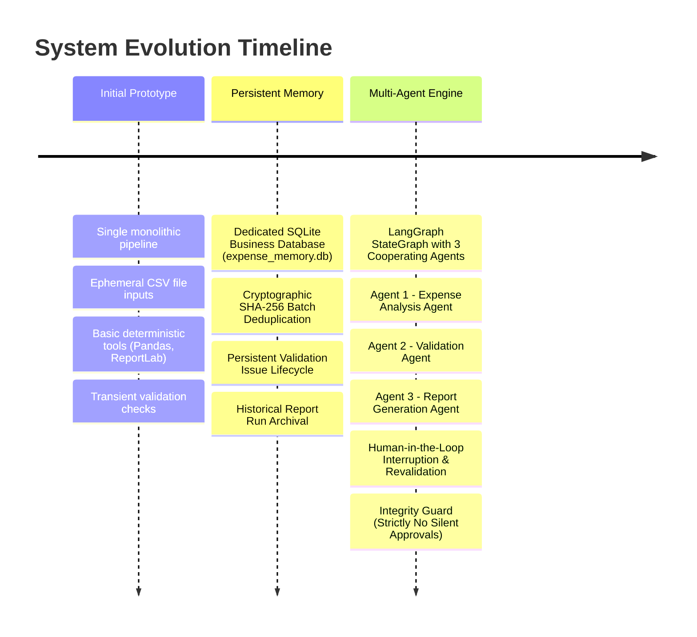
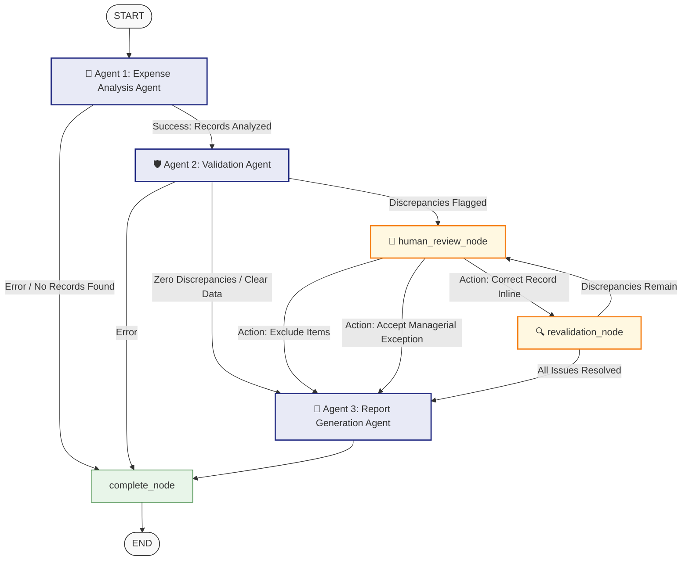
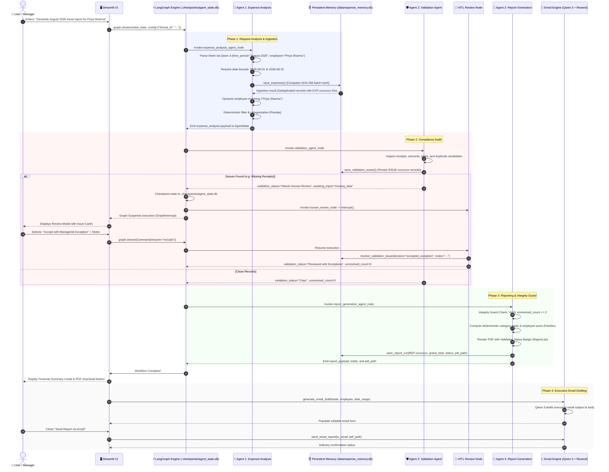

# 📘 System Evolution & Technical Workflow: From Prototype to Enterprise Multi-Agent Architecture

> **Document Summary**: This document details the architectural evolution of the **AI Expense Report Agent**. It explains:
> 1. What the system originally had (baseline architecture, tools, and constraints).
> 2. What was introduced in the **Persistent SQLite Memory & Deduplication System**.
> 3. What was introduced in the **Multi-Agent Collaboration Architecture with LangGraph**.
> 4. **How exactly everything takes place** during runtime execution — step-by-step from user prompt to database persistence, multi-agent handoffs, human review, and publication-grade PDF generation.

---

## 📑 Table of Contents

1. [Executive Summary & Evolution Timeline](#1-executive-summary--evolution-timeline)
2. [What the System Already Had (Baseline Architecture)](#2-what-the-system-already-had-baseline-architecture)
   - [2.1 Initial Monolithic Pipeline](#21-initial-monolithic-pipeline)
   - [2.2 Baseline Computational & Formatting Tools](#22-baseline-computational--formatting-tools)
   - [2.3 Limitations of the Original System](#23-limitations-of-the-original-system)
3. [Persistent SQLite Memory System](#3-persistent-sqlite-memory-system)
   - [3.1 Two-Tier Database Architecture & Separation](#31-two-tier-database-architecture--separation)
   - [3.2 Domain Relational Schema (`data/expense_memory.db`)](#32-domain-relational-schema-dataexpense_memorydb)
   - [3.3 Cryptographic Batch Deduplication (SHA-256)](#33-cryptographic-batch-deduplication-sha-256)
   - [3.4 Memory Management API (`tools/memory_tools.py`)](#34-memory-management-api-toolsmemory_toolspy)
   - [3.5 Cross-Session Recall Without Re-uploading](#35-cross-session-recall-without-re-uploading)
4. [Multi-Agent Collaboration Architecture](#4-multi-agent-collaboration-architecture)
   - [4.1 Decoupling into Three Specialized Collaborating Agents](#41-decoupling-into-three-specialized-collaborating-agents)
   - [4.2 Agent 1: Expense Analysis Agent](#42-agent-1-expense-analysis-agent)
   - [4.3 Agent 2: Validation Agent](#43-agent-2-validation-agent)
   - [4.4 Human-in-the-Loop (HITL) Review Node & Revalidation Node](#44-human-in-the-loop-hitl-review-node--revalidation-node)
   - [4.5 Agent 3: Report Generation Agent & The Integrity Guard](#45-agent-3-report-generation-agent--the-integrity-guard)
   - [4.6 Typed State Schema & Agent Contracts (`state.py`)](#46-typed-state-schema--agent-contracts-statepy)
   - [4.7 Official Validation Status Model](#47-official-validation-status-model)
5. [Side-by-Side Comparison: Before vs. After Modernization](#5-side-by-side-comparison-before-vs-after-modernization)
6. [How Exactly Everything Takes Place (End-to-End Execution Flow)](#6-how-exactly-everything-takes-place-end-to-end-execution-flow)
   - [6.1 Complete Sequence Diagram](#61-complete-sequence-diagram)
   - [6.2 Detailed Step-by-Step Runtime Walkthrough](#62-detailed-step-by-step-runtime-walkthrough)
   - [6.3 Database State Transitions During Execution](#63-database-state-transitions-during-execution)
7. [Automated Verification & Demonstration Playbook](#7-automated-verification--demonstration-playbook)

---

## 1. Executive Summary & Evolution Timeline

The system began as a procedural script and single-agent prototype that read static CSV files to generate basic PDF summaries. While capable of simple text-to-report generation, it suffered from severe real-world limitations: no historical memory, vulnerability to duplicate entries, inability to audit compliance discrepancies across sessions, and a risk of silent approvals.

Through modernization, the system was elevated to an **enterprise-grade, multi-agent AI architecture** backed by persistent SQLite databases, cryptographic deduplication, rigorous compliance auditing, and human-in-the-loop review guards.



---

## 2. What the System Already Had (Baseline Architecture)

In the initial implementation, the application consisted of a single linear workflow and a collection of deterministic helper utilities.

### 2.1 Initial Monolithic Pipeline
- **Single-Node Execution**: The system executed as a single procedural pipeline. An intent-extraction function parsed user input, filtered a DataFrame loaded in memory, checked a few dictionary conditions, computed sums, and called a PDF generator.
- **Stateless Operation**: Data existed solely in memory for the duration of that single script execution or Streamlit session. Once the browser refreshed or the process terminated, all data vanished.
- **Direct CSV Coupling**: The system read directly from [`data/expenses.csv`](file:///c:/Users/Space/OneDrive/Documents/AI%20Agent%20Expense%20report/data/expenses.csv) or from an uploaded file via `pd.read_csv()`.

### 2.2 Baseline Computational & Formatting Tools
The core functional tools handled data manipulation outside the LLM to prevent arithmetic hallucination:
- [`tools/expense_tools.py`](file:///c:/Users/Space/OneDrive/Documents/AI%20Agent%20Expense%20report/tools/expense_tools.py):
  - `get_expenses(csv_path)`: Reads CSV, cleans currency symbols (`₹`, `,`), parses dates.
  - `filter_expenses(expenses, start_date, end_date, expense_type, employee_name)`: Filters records using standard Python comparisons.
- [`tools/validation_tools.py`](file:///c:/Users/Space/OneDrive/Documents/AI%20Agent%20Expense%20report/tools/validation_tools.py):
  - `categorize_expenses(expenses)`: Maps keywords (e.g., *flight*, *hotel*, *taxi*, *dinner*) to categories (`Flight`, `Accommodation`, `Transport`, `Meals`).
  - `validate_expenses(expenses)`: Scanned records for missing receipts (`receipt_status == 'Missing'`) or negative/zero amounts.
- [`tools/calculation_tools.py`](file:///c:/Users/Space/OneDrive/Documents/AI%20Agent%20Expense%20report/tools/calculation_tools.py):
  - `calculate_totals(expenses)`: Aggregates category totals, transaction counts, missing receipt values, and employee sub-totals using Pandas.
- [`tools/pdf_tools.py`](file:///c:/Users/Space/OneDrive/Documents/AI%20Agent%20Expense%20report/tools/pdf_tools.py):
  - `generate_pdf(...)`: Uses ReportLab to generate a styled PDF report.
- [`tools/email_tools.py`](file:///c:/Users/Space/OneDrive/Documents/AI%20Agent%20Expense%20report/tools/email_tools.py):
  - `generate_email_draft(...)`: Uses Qwen 3 (via local Ollama) to draft an executive email subject and body summarizing the report.
  - `send_email_report(...)`: Dispatches the PDF via the Resend API or in simulation mode.

### 2.3 Limitations of the Original System

| Limitation | Impact in Baseline System |
| :--- | :--- |
| **No Long-Term Memory** | Every report generation required reloading a CSV file. Historical reports and previous transactions were lost upon session termination. |
| **Duplicate Ingestion** | Ingesting or uploading the same dataset multiple times caused duplicate records and inflated financial totals. |
| **Transient Issue Tracking** | Flagged compliance issues (e.g., missing receipts) existed only as temporary in-memory dictionaries; no record of who authorized an exception or when it occurred was kept. |
| **No Separation of Agent Roles** | Natural language parsing, compliance auditing, and reporting were bundled together. An error in one phase destabilized the entire pipeline. |
| **Vulnerability to Silent Approvals** | If validation flagged discrepancies, the system lacked a hard enforcement guard preventing the generator from producing an unverified report. |

---

## 3. What Was Added: Persistent SQLite Memory System

The Persistent Memory System introduced an enterprise-grade data store, eliminating the stateless CSV dependency and providing a robust audit trail.

### 3.1 Two-Tier Database Architecture & Separation
A key architectural principle is the strict separation between **business domain data** and **workflow execution state**:

1. **Business Domain Database (`data/expense_memory.db`)**:
   - Implemented in [`tools/memory_tools.py`](file:///c:/Users/Space/OneDrive/Documents/AI%20Agent%20Expense%20report/tools/memory_tools.py).
   - Stores domain entities: normalized transactions, cryptographic file batch hashes, validation findings, report runs, and audit logs.
2. **Workflow Checkpoint Database (`.checkpoints/agent_state.db`)**:
   - Managed automatically by LangGraph's `SqliteSaver`.
   - Stores serialized execution frames, allowing multi-step workflows to pause during human review and resume seamlessly across application restarts.

```
┌────────────────────────────────────────────────────────┐
│                   TWO-TIER STORAGE                     │
├──────────────────────────┬─────────────────────────────┤
│   data/expense_memory.db │ .checkpoints/agent_state.db │
│   (Business Domain Data) │ (LangGraph Workflow State)  │
├──────────────────────────┼─────────────────────────────┤
│ • expenses               │ • Graph Execution Threads   │
│ • import_batches         │ • Node Checkpoints          │
│ • validation_issues      │ • Interrupted Tasks         │
│ • report_runs            │ • State Diffs & Resumes     │
│ • audit_events           │                             │
└──────────────────────────┴─────────────────────────────┘
```

### 3.2 Domain Relational Schema (`data/expense_memory.db`)

The persistent memory database implemented relational tables with strict foreign key constraints and indexing:

#### 1. `expenses` Table
Stores normalized transaction records with stable identifiers:
- `id` (`INTEGER PRIMARY KEY AUTOINCREMENT`)
- `record_id` (`TEXT UNIQUE NOT NULL`): Deterministic identifier (e.g. `EXP-a1b2c3d4e5f6`).
- `expense_date` (`TEXT NOT NULL`): ISO format `YYYY-MM-DD`.
- `employee` (`TEXT NOT NULL`): Employee full name.
- `description` (`TEXT NOT NULL`): Transaction description.
- `merchant` (`TEXT NOT NULL`): Vendor/Merchant name.
- `category` (`TEXT NOT NULL`): Expense category (Flight, Transport, Meals, etc.).
- `amount` (`REAL NOT NULL`): Cleaned monetary amount.
- `receipt_status` (`TEXT NOT NULL`): `Verified`, `Missing`, etc.
- `receipt_path` (`TEXT`): Optional path to receipt file.
- `source_file` (`TEXT NOT NULL`): Name of origin CSV or source.
- `import_hash` (`TEXT NOT NULL`): Cryptographic batch hash.
- `created_at` (`TEXT NOT NULL`), `updated_at` (`TEXT NOT NULL`).
- *Indexes*: `idx_expenses_date`, `idx_expenses_employee`, `idx_expenses_import_hash`.

#### 2. `import_batches` Table
Tracks ingested files to ensure cryptographic deduplication:
- `id` (`INTEGER PRIMARY KEY AUTOINCREMENT`)
- `batch_id` (`TEXT UNIQUE NOT NULL`)
- `source_name` (`TEXT NOT NULL`)
- `file_hash` (`TEXT NOT NULL`): SHA-256 fingerprint of payload.
- `record_count` (`INTEGER NOT NULL`)
- `imported_at` (`TEXT NOT NULL`)

#### 3. `validation_issues` Table
Maintains the complete compliance audit trail:
- `id` (`INTEGER PRIMARY KEY AUTOINCREMENT`)
- `issue_id` (`TEXT UNIQUE NOT NULL`): e.g. `ISSUE-9f8e7d6c5b4a`.
- `expense_record_id` (`TEXT NOT NULL`): Foreign key referencing `expenses.record_id`.
- `issue_type` (`TEXT NOT NULL`): `missing_receipt`, `invalid_amount`, `missing_date`, `duplicate`.
- `field_name` (`TEXT NOT NULL`): Name of flagged field.
- `message` (`TEXT NOT NULL`): Human-readable audit message.
- `severity` (`TEXT NOT NULL`): `high`, `medium`, `low`.
- `status` (`TEXT NOT NULL`): `unresolved`, `accepted_exception`, `excluded`, `resolved`.
- `detected_at` (`TEXT NOT NULL`), `resolved_at` (`TEXT`).
- `reviewer_decision` (`TEXT`), `reviewer_notes` (`TEXT`).

#### 4. `report_runs` Table
Archives generated reports for compliance verification:
- `id` (`INTEGER PRIMARY KEY AUTOINCREMENT`)
- `report_id` (`TEXT UNIQUE NOT NULL`): e.g. `REP-5c4b3a210f`.
- `user_request` (`TEXT NOT NULL`): Prompt that triggered the run.
- `filters_json` (`TEXT NOT NULL`): Date, employee, category filters.
- `transaction_ids_json` (`TEXT NOT NULL`): Array of included `record_id` strings.
- `transaction_count` (`INTEGER NOT NULL`), `grand_total` (`REAL NOT NULL`).
- `validation_status` (`TEXT NOT NULL`): `Clear`, `Reviewed with Exceptions`, `Needs Human Review`.
- `report_file_path` (`TEXT NOT NULL`), `human_review_status` (`TEXT NOT NULL`).
- `created_at` (`TEXT NOT NULL`).

#### 5. `audit_events` Table
Immutable chronological event log:
- `id` (`INTEGER PRIMARY KEY AUTOINCREMENT`)
- `event_id` (`TEXT UNIQUE NOT NULL`)
- `event_type` (`TEXT NOT NULL`): `batch_import`, `issue_detected`, `issue_resolved`, `report_generated`.
- `entity_type` (`TEXT NOT NULL`), `entity_id` (`TEXT NOT NULL`).
- `details_json` (`TEXT NOT NULL`), `created_at` (`TEXT NOT NULL`).

### 3.3 Cryptographic Batch Deduplication (SHA-256)
To eliminate duplicate records, `save_expenses()` computes an SHA-256 hash across the normalized payload:

$$\text{Hash} = \text{SHA256}(\text{source\_name} + \text{normalized\_records\_json})$$

- If an incoming file's hash already exists in `import_batches`, insertion is bypassed and existing records are returned with zero data duplication.
- Legitimate duplicates (such as two identical taxi fares on the same day) are preserved with distinct `record_id` tags so that the Validation Agent can audit them.

### 3.4 Memory Management API (`tools/memory_tools.py`)
The memory architecture exposed modular, thread-safe functions:
- `init_memory_db(db_path)`: Bootstraps tables and indexes safely.
- `save_expenses(expenses, source_name, db_path)`: Persists transactions with deduplication.
- `retrieve_expenses_from_db(...)`: Filtered SQL queries by employee, date range, and category.
- `save_validation_issues(issues, db_path)`: Persists detected discrepancies.
- `update_expense_record(record_id, updates, db_path)`: Updates transactions when edited by a reviewer.
- `resolve_validation_issue(issue_id, decision, notes, db_path)`: Updates issue resolution status.
- `save_report_run(report_data, db_path)`: Archives completed report runs.
- `get_report_history(limit, db_path)`: Fetches past report generations.
- `get_unresolved_issues(employee, db_path)`: Queries open compliance discrepancies.
- `get_memory_stats(db_path)`: Computes summary counts for UI dashboards.

### 3.5 Cross-Session Recall Without Re-uploading
Because data is persisted in SQLite, users can request:
> *"Generate August 2026 travel report for Priya Sharma"*

The agent directly retrieves records from `data/expense_memory.db` without needing any CSV file to be uploaded or re-parsed.

---

## 4. Multi-Agent Collaboration Architecture

The system transformed the monolithic script into a **cooperative multi-agent system** orchestrated by **LangGraph StateGraph**.



### 4.1 Decoupling into Three Specialized Collaborating Agents
Instead of a single function doing everything, three specialized agents communicate via typed contracts:

1. **Expense Analysis Agent**: Semantic interpretation, memory retrieval, deterministic filtering, and categorization.
2. **Validation Agent**: Policy compliance auditing, duplicate detection, and SQLite issue recording.
3. **Report Generation Agent**: Integrity enforcement, deterministic financial calculation, ReportLab PDF rendering, and report-run archiving.

---

### 4.2 Agent 1: Expense Analysis Agent
- **Function**: `expense_analysis_agent_node(state)` in [`agent.py`](file:///c:/Users/Space/OneDrive/Documents/AI%20Agent%20Expense%20report/agent.py#L208-L375)
- **Primary Responsibilities**:
  1. **Intent Extraction**: Utilizes local **Qwen 3 4B** via Ollama to extract JSON fields (`expense_type`, `time_period`, `employee_name`). Automatically falls back to regex pattern matching if Ollama is unreachable.
  2. **Relative Time Period Resolution**: Maps terms like *"last month"*, *"August 2026"*, or *"April to May"* into exact ISO date bounds (`start_date`, `end_date`).
  3. **Persistent Memory Interfacing**: Ingests active CSV inputs into `data/expense_memory.db` or queries existing transactions.
  4. **Dynamic Employee Matching**: Inspects distinct employee names in the database. Performs fuzzy matching against the prompt (e.g., matching *"priya"* to *"Priya Sharma"*) without any hardcoded names.
  5. **Deterministic Filtering & Categorization**: Filters records by date and category using Pandas, and assigns standardized categories.
  6. **Structured Handoff**: Produces the `expense_analysis` contract in state.

---

### 4.3 Agent 2: Validation Agent
- **Function**: `validation_agent_node(state)` in [`agent.py`](file:///c:/Users/Space/OneDrive/Documents/AI%20Agent%20Expense%20report/agent.py#L382-L437)
- **Primary Responsibilities**:
  1. **Compliance Policy Auditing**: Examines every transaction passed by Agent 1 against organizational policies:
     - Missing receipt check (`receipt_status` is missing, null, or unverified).
     - Non-positive or zero amount check (`amount <= 0`).
     - Required field completeness (valid date, description, merchant).
     - Duplicate transaction detection (same merchant, amount, and date).
  2. **Memory Persistence**: Automatically commits all flagged discrepancies into the `validation_issues` table in `data/expense_memory.db`.
  3. **Routing Decision**:
     - If **zero issues** exist: Sets `validation_status = "Clear"`, routes directly to Agent 3.
     - If **issues detected**: Sets `validation_status = "Needs Human Review"`, sets `awaiting_input = "missing_data"`, and halts for human review.
  4. **Structured Handoff**: Emits `validation_findings` and `unresolved_count` into state.

---

### 4.4 Human-in-the-Loop (HITL) Review Node & Revalidation Node
- **Functions**: `human_review_node(state)` and `revalidation_node(state)` in [`agent.py`](file:///c:/Users/Space/OneDrive/Documents/AI%20Agent%20Expense%20report/agent.py#L443-L570)
- **Suspension via LangGraph `interrupt()`**: Freezes execution state into `.checkpoints/agent_state.db` and prompts the user in the UI.
- **Three Reviewer Actions**:
  1. **Exclude Flagged Items**:
     - Strips flagged transactions from `categorized_expenses`.
     - Updates issues in `validation_issues` to `excluded`.
     - Sets `validation_status = "Clear"` and proceeds to Agent 3.
  2. **Accept with Documented Exception**:
     - Preserves transactions in the report under managerial authorization.
     - Updates issues in `validation_issues` to `accepted_exception` along with reviewer notes.
     - Sets `validation_status = "Reviewed with Exceptions"` and proceeds to Agent 3.
  3. **Inline Edit & Revalidate**:
     - Reviewer corrects a field (e.g. attaches verified receipt status or fixes an amount).
     - Updates the record in `data/expense_memory.db`.
     - Routes to `revalidation_node`, which re-audits the single record. If clean, transitions to `Clear`; if discrepancies remain, re-prompts the reviewer.

---

### 4.5 Agent 3: Report Generation Agent & The Integrity Guard
- **Function**: `report_generation_agent_node(state)` in [`agent.py`](file:///c:/Users/Space/OneDrive/Documents/AI%20Agent%20Expense%20report/agent.py#L577-L721)
- **Primary Responsibilities**:
  1. **The Integrity Guard (No Silent Approvals)**:
     - Asserts that either `unresolved_count == 0` or an authorized exception status (`Reviewed with Exceptions`) is present.
     - If unresolved issues remain, the agent **actively aborts execution**, preventing invalid reports from being generated.
  2. **Deterministic Financial Math**: Calculates grand totals, category subtotals, and per-employee breakdowns using Pandas. The LLM is **never** permitted to calculate numbers.
  3. **Publication-Grade PDF Rendering**: Renders a multi-page ReportLab PDF including:
     - Prominent **Validation Status Badges**.
     - Financial summary cards and category breakdowns.
     - Itemized transaction tables.
     - Formal managerial approval blocks.
  4. **Archival to SQLite Memory**: Persists the report run metadata into the `report_runs` table in `data/expense_memory.db`.

---

### 4.6 Typed State Schema & Agent Contracts (`state.py`)

All three agents, the review nodes, and the checkpointer interact exclusively through the typed [`AgentState`](file:///c:/Users/Space/OneDrive/Documents/AI%20Agent%20Expense%20report/state.py#L14-L74) dictionary:

```python
class AgentState(TypedDict, total=False):
    # Conversation Messages
    messages: Annotated[list, add_messages]
    
    # Identification & Memory Tracking
    report_run_id: str          # e.g., "REP-xxxxxxxx"
    data_source: str            # 'memory_db' | 'csv_file' | 'interactive_editor'
    
    # Request Parsing
    user_request: str
    start_date: str
    end_date: str
    expense_type: str
    employee_name: str
    target_employee: str
    
    # Multi-Agent Structured Handoffs
    expense_analysis: dict      # Output from Agent 1 (Expense Analysis Agent)
    validation_findings: list   # Output from Agent 2 (Validation Agent)
    unresolved_count: int       # Open compliance issues
    validation_status: str      # 'Clear' | 'Needs Human Review' | 'Reviewed with Exceptions'
    human_decisions: list       # Audit log of HITL reviewer actions
    human_response: str         # "include" | "exclude" | "correct"
    report_payload: dict        # Output from Agent 3 (Report Generation Agent)
    
    # Deterministic Data Pipeline
    expenses: list              # Ingested transactions
    filtered_expenses: list     # Filtered transactions
    categorized_expenses: list  # Cleaned, categorized records
    missing_data: list          # Flagged issues list
    totals: dict                # Calculated financial math
    pdf_path: str               # File path to generated PDF
    
    # Email Dispatch & Logging
    recipient_email: str
    email_subject: str
    email_body: str
    email_status: str
    agent_logs: list            # Structured log of agent thoughts & actions
    workflow_status: list       # UI progress updates
    awaiting_input: str         # "" | "missing_data"
    error: str
```

---

### 4.7 Official Validation Status Model

The system enforces three official validation statuses across the UI, the SQLite database, and the generated PDF:

| Validation Status | Meaning | Final Report Permitted? | PDF Header Badge |
| :--- | :--- | :---: | :--- |
| **`Clear`** | 100% compliant. Zero unresolved issues; all receipts and amounts verified. | **Yes** | 🟢 **`VERIFIED & CLEAR`** |
| **`Reviewed with Exceptions`** | Non-compliant items were reviewed and approved under documented managerial exception. | **Yes** | 🟡 **`REVIEWED WITH DOCUMENTED EXCEPTIONS`** |
| **`Needs Human Review`** | Discrepancies exist and have not received authorized review. | **No** (Aborted by Agent 3) | 🔴 **`AWAITING HUMAN REVIEW`** |

---

## 5. Side-by-Side Comparison: Before vs. After Modernization

| Capability | Baseline Prototype | Modernized Multi-Agent Platform |
| :--- | :--- | :--- |
| **Architecture** | Single procedural script / monolithic pipeline. | **3 Collaborating Agents** organized in a LangGraph StateGraph. |
| **Data Storage** | Ephemeral; static CSV loaded into memory on each run. | **Two-Tier SQLite Architecture**: Domain Memory (`expense_memory.db`) + Graph State (`agent_state.db`). |
| **Deduplication** | None; re-uploading a file duplicated records and inflated totals. | **Cryptographic SHA-256 Batch Fingerprinting**; duplicate uploads skipped. |
| **Query Flexibility** | Required re-uploading CSV files. | **Cross-Session Retrieval** directly from persistent SQLite memory. |
| **Compliance Auditing** | In-memory warnings that disappeared after script ended. | **Persistent Issue Lifecycle** (`unresolved`, `accepted_exception`, `excluded`, `resolved`). |
| **Human-in-the-Loop** | Basic CLI or Streamlit pause without durable state save. | **Durable `interrupt()` & Checkpointing** in SQLite; allows resumption across sessions. |
| **Approval Integrity** | Vulnerable to silent approvals if issues were ignored. | **Strict Integrity Guard**: Agent 3 aborts if unapproved issues remain. |
| **Report Verification** | Generic PDF output. | **Publication-grade PDF with Official Validation Badges** & ReportLab layout. |
| **Audit Trails** | No historical record of reports. | **Full Archival**: `report_runs` and `audit_events` tables track every action. |
| **Email Communication** | Manual dispatch or static email. | **AI-Drafted Executive Summary (Qwen 3)** with Resend API / simulation dispatch. |

---

## 6. How Exactly Everything Takes Place (End-to-End Execution Flow)

This section traces the exact chronological execution of a user request through the multi-agent system and databases.

### 6.1 Complete Sequence Diagram



---

### 6.2 Detailed Step-by-Step Runtime Walkthrough

#### Step 1: User Submission & State Initialization
1. The user enters a natural-language prompt in the Streamlit UI or CLI (e.g. `"Generate travel expense report for last month"`).
2. The UI assigns a fresh `thread_id` UUID and initializes `AgentState`.
3. The compiled LangGraph workflow initiates execution at `START`, routing to `expense_analysis_agent`.

#### Step 2: Agent 1 Processes the Request
1. **NLU Extraction**: Agent 1 invokes `_llm_extract_intent()`. If local Ollama is active, Qwen 3 outputs:
   ```json
   {"expense_type": "travel", "time_period": "august 2026", "employee_name": "Priya Sharma"}
   ```
   If Ollama is offline, regex heuristics extract the same intent.
2. **Date Bound Calculation**: `_resolve_date_range()` converts `"august 2026"` into `start_date = "2026-08-01"` and `end_date = "2026-08-31"`.
3. **Memory Synchronization**: Incoming data is processed by `save_expenses()`:
   - Computes SHA-256 fingerprint of the batch.
   - Inserts records into `expenses` in `data/expense_memory.db` with deterministic `record_id` values (`EXP-xxxxxxxx`).
   - If previously ingested, returns existing records with zero duplicate rows.
4. **Dynamic Employee Discovery**: Scans unique employee names from the dataset. Matches `"Priya Sharma"` without hardcoded values.
5. **Deterministic Filtering & Categorization**: Filters records where `2026-08-01 <= expense_date <= 2026-08-31` and `category == 'Travel'`. Categorizes merchants (e.g., *IndiGo* $\rightarrow$ *Flight*, *Taj Hotels* $\rightarrow$ *Accommodation*).
6. **Handoff**: State is updated with `expense_analysis`, `filtered_expenses`, and `categorized_expenses`. The conditional edge `route_after_analysis` forwards execution to `validation_agent`.

#### Step 3: Agent 2 Audits Policy Compliance
1. Agent 2 inspects each transaction in `categorized_expenses`:
   - Checks if `receipt_status` is in `("missing", "no", "n/a")`.
   - Checks if `amount <= 0`.
   - Identifies potential duplicate candidate records.
2. **Persistence**: Flagged discrepancies are recorded in `validation_issues` in `data/expense_memory.db` with status `unresolved`.
3. **Routing Evaluation**:
   - If issues exist: Sets `validation_status = "Needs Human Review"` and `awaiting_input = "missing_data"`. The conditional edge `route_after_validation` directs execution to `human_review_node`.
   - If clean: Sets `validation_status = "Clear"`. The conditional edge directs execution directly to `report_generation_agent`.

#### Step 4: Human-in-the-Loop Interruption & Resolution (If Issues Flagged)
1. In `human_review_node`, LangGraph's `interrupt()` executes.
2. The checkpointer writes the current thread state to `.checkpoints/agent_state.db`.
3. The graph suspends, and the Streamlit UI displays the interactive review modal detailing each flagged issue.
4. The reviewer selects one of three actions:
   - **Exclude**: User selects *"Exclude"*. The system removes the flagged transactions, resolves issues as `excluded` in `data/expense_memory.db`, sets `validation_status = "Clear"`, and resumes to Agent 3.
   - **Accept Exception**: User selects *"Accept with Managerial Exception"* and enters notes (e.g., *"Approved by VP of Sales"*). The system marks issues as `accepted_exception` in `data/expense_memory.db`, sets `validation_status = "Reviewed with Exceptions"`, and resumes to Agent 3.
   - **Correct**: User edits an amount or attaches a receipt in the table editor. The system updates the record in SQLite memory and routes to `revalidation_node`. If re-validation passes, execution continues to Agent 3; otherwise, it re-prompts the reviewer.

#### Step 5: Agent 3 Validates Integrity & Generates Report
1. **Integrity Guard**: Agent 3 inspects `unresolved_count`. If open, unreviewed discrepancies remain, execution **aborts immediately** with an error. Silent approval is strictly prohibited.
2. **Deterministic Calculations**: Agent 3 invokes `calculate_totals()`:
   - Calculates exact category sums, grand total, and transaction count using Pandas.
3. **Publication-Grade PDF Engine**: Agent 3 calls `generate_pdf()`:
   - Evaluates the validation status.
   - Draws a green (`VERIFIED & CLEAR`) or amber (`REVIEWED WITH DOCUMENTED EXCEPTIONS`) banner at the top of the PDF.
   - Formats financial summary cards, category tables, itemized expense rows, and signature lines.
   - Saves the generated PDF into the `reports/` folder.
4. **Memory Archival**: Calls `save_report_run()` to commit report metadata (`report_id`, `grand_total`, `filters_json`, `pdf_path`, `validation_status`) to `data/expense_memory.db`.
5. **Handoff**: Routes to `complete_node`, which logs success and finishes graph execution.

#### Step 6: Completion & AI Email Dispatch
1. The Streamlit UI displays the final metrics, agent activity log, and a download button for the generated PDF.
2. In the email section, `generate_email_draft()` queries Qwen 3 via local Ollama to craft an executive subject line and professional summary body.
3. The user reviews or edits the text, enters the recipient's address, and clicks **"Send Report via Email"**. The PDF is attached and sent via the Resend API (or logged in simulation mode).

---

### 6.3 Database State Transitions During Execution

The table below illustrates how the SQLite databases mutate throughout each phase of execution:

```
[Phase 1: Ingestion]
  data/expense_memory.db:
    ├── import_batches: INSERT (batch_id, file_hash, record_count=170)
    └── expenses:       INSERT (170 rows, record_id='EXP-xxx', import_hash)

[Phase 2: Validation]
  data/expense_memory.db:
    └── validation_issues: INSERT (issue_id='ISSUE-xxx', status='unresolved')

[Phase 3: HITL Suspension]
  .checkpoints/agent_state.db:
    └── checkpoints: INSERT (thread_id, state_snapshot, interrupt_point)

[Phase 4: Human Decision (Accept Exception)]
  data/expense_memory.db:
    ├── validation_issues: UPDATE status='accepted_exception', reviewer_decision='approved'
    └── audit_events:      INSERT (event_type='issue_resolved', details)

[Phase 5: Report Generation]
  data/expense_memory.db:
    ├── report_runs:  INSERT (report_id='REP-xxx', grand_total, status='Reviewed with Exceptions')
    └── audit_events: INSERT (event_type='report_generated', details)
```

---

## 7. Automated Verification & Demonstration Playbook

The entire system's functionality is verified through comprehensive test suites consolidated in `tests/`:

### 1. Run Complete Automated Test Suite (324 Tests)
```bash
pytest
```

### 2. Verify Persistent SQLite Memory & Isolation
```bash
pytest tests/test_milestone1_db.py
```
*Verifies*: Database schema initialization, migrations, cryptographic SHA-256 deduplication, query retrieval with dataset isolation, issue persistence, field updates, and report-run history.

### 3. Verify Multi-Agent Collaboration & Integrity Guard
```bash
pytest tests/test_memory_and_agents.py
pytest tests/test_milestone3_compliance.py
```
*Verifies*: Agent 1 structured output, Agent 2 compliance audit, Agent 3 deterministic math, Agent 3 integrity guard refusal on unapproved data, Human-in-the-Loop review actions (exclude, accept exceptions, revalidate), and persistent memory of auditor decisions.

### 4. Direct CLI Database Verification
Inspect live SQLite memory metrics directly from PowerShell:
```bash
# Display summary metrics of persistent memory
python -c "from tools.memory_tools import get_memory_stats; print(get_memory_stats())"

# Query the most recent historical report run
python -c "from tools.memory_tools import get_report_history; print(get_report_history(limit=1))"
```
